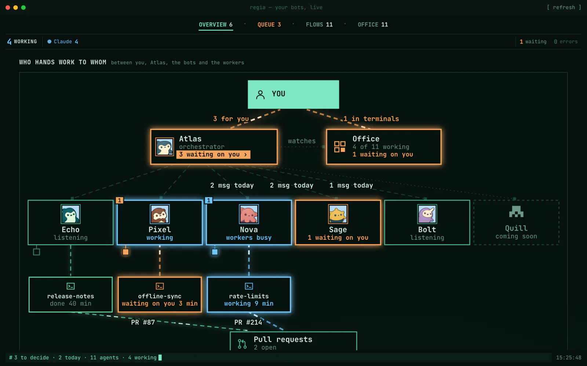
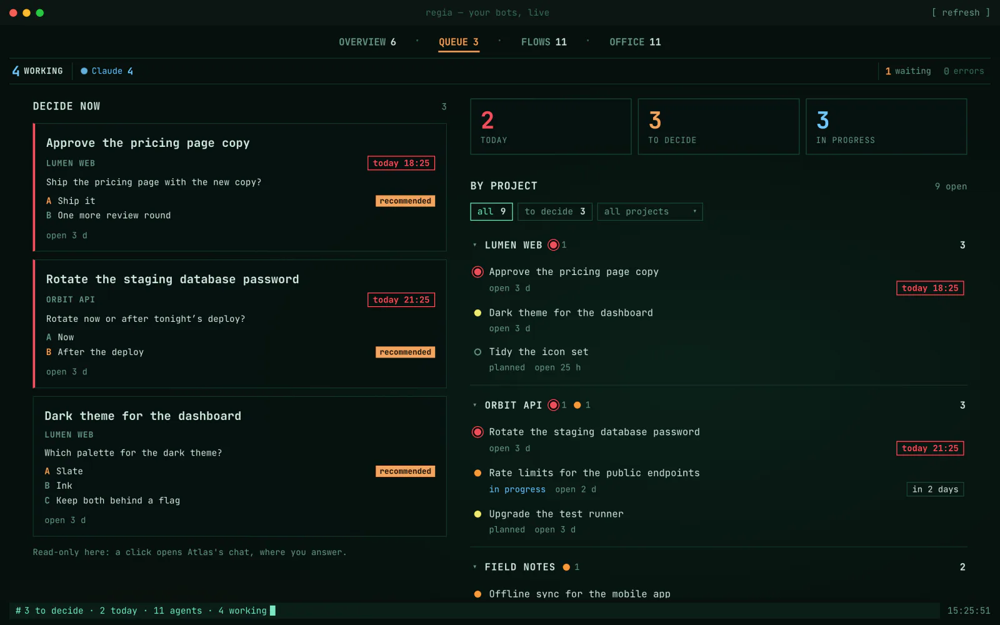
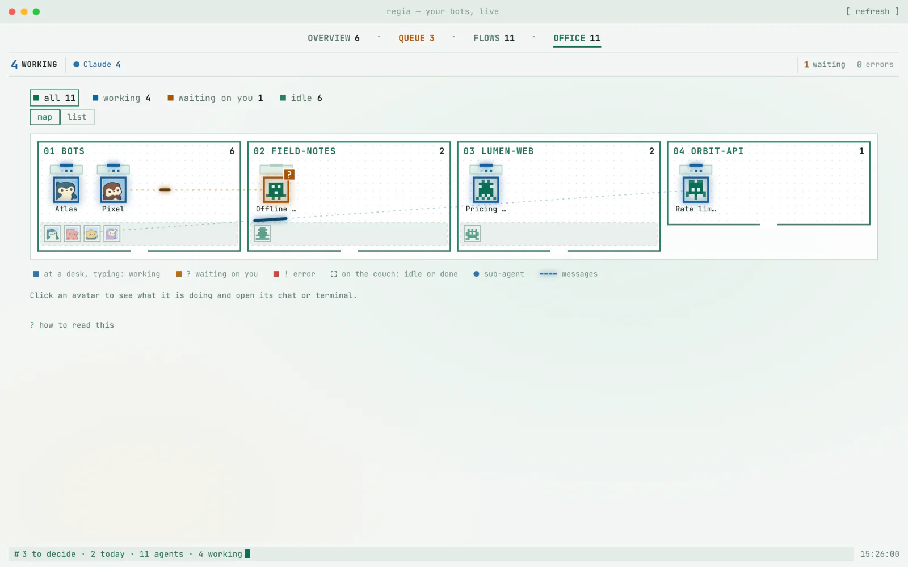

# Regia

A read-only control room for your [Orca](https://github.com/stablyai/orca) bots, in a panel of the right sidebar. It answers four questions without opening a chat: what is waiting on you, what is in the queue, who is working on what, and how work flows between bots, workers and pull requests.

It only shows. It never answers a bot, writes to an agent or a terminal, or presses a permission for you. A click takes Orca to a chat, a terminal or a workspace.



The pictures on this page are mock-ups: the panel itself, on invented bots and projects.

## What you get

| View | What it shows |
|---|---|
| **Overview** | A diagram of who hands work to whom: you, the bots, the agents each bot started, the pull requests. Dashes flow toward whoever receives the work; amber means something waits on you. Below it, one card per bot: what it is doing now, its open items, the agents it started, its next automation, the last thing it said. |
| **Queue** | "Decide now": up to five items that wait on your answer, with the question and its options. Then every open item in lanes, by priority and deadline. |
| **Flows** | The same diagram, and the recent messages between bots, coordinators and workers: subject and first line. |
| **Office** | Every agent in every workspace, grouped by project: working, waiting on you, idle. A click takes Orca to that agent. |

Above every view, a scoreboard counts the agents working now, by provider, and those waiting on you or failing. A status bar item shows how many decisions wait ("Regia · 3 to decide · 1 today"), and a desktop notification tells you when something new is waiting; it is never repeated for the same thing.

The panel updates by itself every few seconds, follows Orca's light or dark theme, and stops its animations when your system asks to reduce motion.

| | |
|---|---|
|  |  |
|  |  |

## Install

```sh
orca plugin install cryptosecco/orca-regia-plugin --json
```

Orca answers with what the plugin would be granted and a command to approve it. Read that list (it is the one below), then run the command it prints. To try it from a folder while you change it: `orca plugin dev load <folder> --json`.

Needs Orca 1.4.259 or newer. English only, for now.

## With a paired Orca server

If Orca on this machine is the window and a paired Orca server holds your bots and projects, the plugin reads both. Orca's CLI on this machine lists the server's bots but answers everything else for this machine only, so the plugin sends each bot's commands to the server the bot lives on (`--environment <name>`), and reads workspaces, messages, orchestration workers and automations from this machine and from every paired server, then joins them. Which servers exist it learns from the CLI itself; nothing has to be set. The header names the servers it reads, and says when one is not answering: what that server holds stays on screen as it was last read.

A command to a server crosses the network and takes about a second, so those run up to six at a time; commands to this machine still run one after another.

## What it is allowed to do

It is a full-access plugin (`trusted-worker`): part of it is Node code that runs with your user account. It has to be, because Orca's plugin API has no way to list bots, their items or the messages between agents; the plugin gets those by running Orca's own `orca` command.

It asks Orca for six capabilities:

| Capability | Used for |
|---|---|
| `workspace:read` | listing workspaces, to take you to one on a click; hearing when one changes |
| `agent:read` | hearing when an agent's status changes, to refresh at once |
| `workspace:write` | the click: show a workspace, focus a terminal, show the right sidebar. Nothing else is written |
| `notifications:show` | the desktop notification; a setting turns it off |
| `storage:own` | remembering which waits you were already told about, and which lanes you collapsed |
| `settings:own` | reading the settings below |

### What it reads

- **The Orca CLI**, from a fixed list of eight read commands: `bot list`, `bot item list`, `bot work list`, `bot chats`, `worktree ps`, `automations list`, `orchestration inbox`, `orchestration worker-list`. A bot enters a command only by its id, and a paired server only by its name. On Linux the CLI is `orca-ide`; plain `orca` there is the GNOME screen reader, and the plugin never runs it.
- **`~/.orca/bots/<bot>/bot.json`**, for the bot's id, name and avatar; and the bot's uploaded picture in that folder, if it has one (up to 1 MB, checked to be a real image, links refused).
- **Orca's own mascot pictures**, from the Orca app on your machine, for bots that use one. The plugin does not ship them.
- **Nothing else.** In particular, no file of your projects.

Messages between agents are read whole by the worker and cut to subject and first line before anything is shown or stored. Prompts, tool input and terminal previews are dropped.

### What it never does

- No network: it makes no request to any server, and Orca's panel frame has no network anyway.
- No telemetry, analytics or tracking of any kind.
- No dependencies: no package is installed, nothing is downloaded, there is no build step.
- No writing outside its own storage in Orca. It creates and changes no file.

## Settings

Everything works with nothing set. Settings → Plugins → Regia:

| Setting | Default | What it does |
|---|---|---|
| **Bot that holds the queue** | empty | If one bot orchestrates the others, write its name or id: the Queue becomes that bot's items, in lanes by project. Empty: the Queue shows the open items of every bot, in one lane per bot. |
| **Read priority and project from item titles** | on | See "Titles" below. Off: titles are shown as they are. |
| **Project order** | empty | Project names separated by commas, in the order you want their lanes. Others follow alphabetically. |
| **Animations** | follow the system | "Off" stops them always. |
| **Notify when something new is waiting on you** | on | |
| **Slow refresh, in seconds** | 20 | The queue, agent states and messages are re-read every 4 seconds; everything else in turns, and this is how long a full turn takes (10 to 300). |
| **Bots not there yet** | empty | Names shown dashed in the diagram until a bot with that name exists. |
| **State file (optional)** | empty | See "The optional state file" below. Empty: off. |
| **Orca CLI executable** | empty | Only if the CLI is somewhere unusual. Empty: the CLI of the Orca app that runs the plugin, then the PATH (`orca`; on Linux `orca-ide`). |
| **Paired Orca servers** | empty | Empty: every paired server Orca reports is read, next to this machine. Names separated by commas: only those. `local`: this machine only. |

### Titles

If you (or the bot that keeps your queue) write item titles like this, the Queue sorts them by priority and deadline and groups them by project:

```text
🔴 Website · Approve the pricing page · ⏰ 24/12 17:00
```

| Part | Meaning |
|---|---|
| the dot | 🔴 today or overdue, 🟠 within 3 days, 🟡 this week, ⚪ whenever |
| `Website` | the project, up to the first `·` |
| `⏰ 24/12 17:00` | an optional deadline: day/month, and optionally the time. `⏰ 24/12` means by the end of that day |

A deadline of today, or one already passed, moves the item to the top whatever its dot says. A title written any other way is left exactly as it is, with no priority and no project: nothing is guessed. Dates are day first, then month.

### The optional state file

Orca's CLI tells the plugin which agents exist and what state they are in. It does not tell which model an agent runs, how full its context is, or which files it touches. If you have a tool that writes that to a JSON file, give its path here and the Office gains model, effort, context and cache for each agent, and a fifth view, **Overlaps**, shows when two agents touch the same files.

Without it nothing is missing from the other views, and no file is looked for. The format is the one the plugin's `normaMotore` function reads (`src/norma.ts`); it is not a standard and may change.

## Limits

- Orca's CLI returns up to 50 open items per bot and the last 40 messages; the panel shows those.
- A bot's mascot is shown only where the Orca app is at its default macOS location. Elsewhere the bot gets a drawn icon derived from its name; uploaded pictures and emoji avatars work everywhere.
- Names in the message list are inferred: Orca's mail records terminals and sessions, not names.
- A bot that lives on a paired server gets a drawn icon: its picture is a file on the server, which the plugin does not read.
- Tried on macOS and Linux, not on Windows.

## Tests

```sh
orca plugin validate . --json
orca plugin test . --json
```

`src/generic.test.ts` runs the plugin on invented data (`demo/demo.mjs`) with nothing configured, and checks what the worker reads, launches and calls. The bots, projects and people in that file are made up.

## How it is made

| File | What it does |
|---|---|
| `orca-plugin.json` | the manifest: panel, command, status bar item, events, settings, capabilities |
| `src/worker.ts` | the worker: reading rounds that never overlap, the status bar, notifications, the click |
| `src/fonti.ts` | the sources outside the plugin API: the CLI's fixed command list, the bot folders, the optional state file |
| `src/norma.ts` | pure functions: from raw data to the picture the panel draws |
| `src/opzioni.ts` | the settings and their neutral defaults |
| `src/protocol.ts` | the contract between worker and panel |
| `panel/viste.js` | the views as pure functions: from the picture to HTML |
| `panel/testi.js` | every text of the panel, in one table |
| `panel/regia.js`, `index.html`, `regia.css` | the page: asks for the picture, redraws what changed, runs the clicks |

No build step: Orca loads the TypeScript as it is written. Code comments and identifiers are in Italian; everything a user sees is in English.

## License

MIT. See [LICENSE](LICENSE).

---

Co-authored by Danilo (human) and HAL (agent) — https://agentisallyouneed.dev
