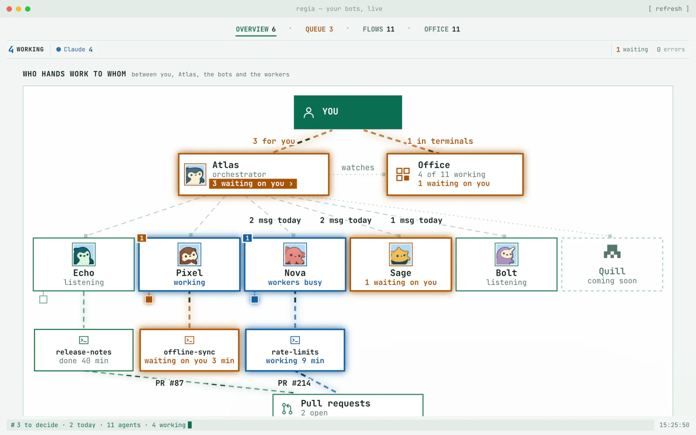
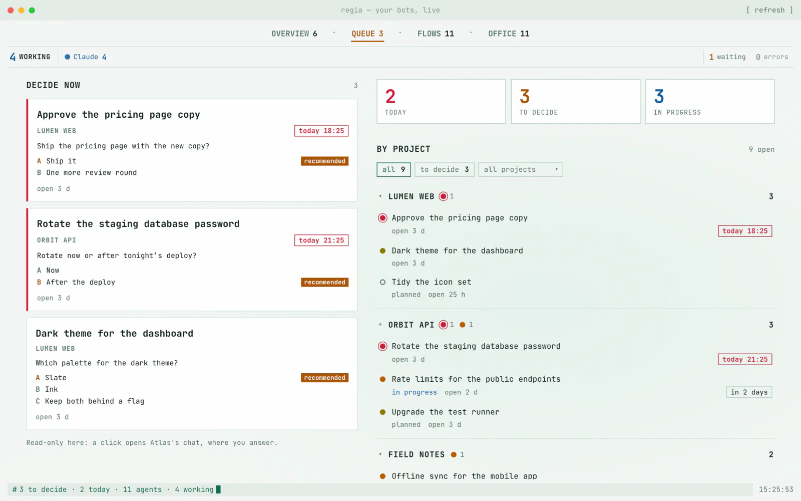

# Regia

A control room for your [Orca](https://github.com/stablyai/orca) bots, in a panel of the right sidebar. It answers four questions without opening a chat: what is waiting on you, what is in the queue, who is working on what, and how work flows between bots, workers and pull requests.

It only shows, with one exception you turn on yourself: if you pick a bot in the Queue's **Send choices to** menu, a click on an option of a question sends your choice to that bot, once. With nobody picked (the default) it sends nothing, ever. It never writes to an agent or a terminal, never answers an item by itself, and never presses a permission for you. Any other click takes Orca to a chat, a terminal or a workspace.


The pictures on this page are mock-ups: the panel itself, on invented bots and projects.

## What you get

| View | What it shows |
|---|---|
| **Overview** | A diagram of who hands work to whom: you, the bots, the agents each bot started, the pull requests. Dashes flow toward whoever receives the work; amber means something waits on you. Below it, one card per bot: what it is doing now, its open items, the agents it started, its next automation, the last thing it said. |
| **Queue** | "Decide now": up to five items that wait on your answer, each question with its options as buttons (the recommended one marked). Then every open item in lanes, by priority and deadline. See "Choices" below for what a button does. |
| **Flows** | The same diagram, and the recent messages between bots, coordinators and workers: subject and first line. |
| **Office** | A map seen from above: one room per project, one avatar per bot and agent. A bot is one avatar however many chats it has, showing its most active one; the workers it started are agents of their own. Who is working sits at a desk, who waits on you has a question mark, the others rest on the couch. A click on an avatar opens its card, with the button for its chat or terminal. The list of before is one click away ("list"). |

Above every view, a scoreboard counts the agents working now, then by provider (only providers with someone at work), and those waiting on you or failing. Hovering or pressing a number lists exactly those agents, and from there one click goes to the agent or to the Office already filtered. Providers are shown by the mark of the CLI the agent runs where the vendor's rules allow it (the `>_` of Codex, the mark of Grok CLI), and by a plain shape with the name written next to it otherwise (Claude Code, Gemini CLI). See "CLI marks" below.

The header stays silent while everything arrives: a line appears only when a source stops answering. Long explanations sit behind "how to read this". A status bar item shows how many decisions wait ("Regia · 3 to decide · 1 today"), and a desktop notification tells you when something new is waiting; it is never repeated for the same thing.

If you run third-party code in an audit sandbox that writes status files (see "The audit sandbox" below), the panel shows it: "2 in sandbox" and "3 blocked" in the scoreboard, a lock on whoever is running something, a fenced **Sandbox** room in the Office that they walk into while the run goes, a red flash at every blocked attempt, and on a click the run itself, live, then its log. Without such a sandbox none of this appears.

The panel updates by itself every few seconds, follows Orca's light or dark theme, and stops its animations when your system asks to reduce motion.

| | |
|---|---|
|  |  |
|  |  |

## Install

```sh
orca plugin install cryptosecco/orca-regia-plugin --json
```

Orca answers with what the plugin would be granted and a command to approve it. Read that list (it is the one below), then run the command it prints. To try it from a folder while you change it: `orca plugin dev load <folder> --json`.

Needs Orca 1.4.259 or newer. English only, for now.

## What it is allowed to do

It is a full-access plugin (`trusted-worker`): part of it is Node code that runs with your user account. It has to be, because Orca's plugin API has no way to list bots, their items or the messages between agents; the plugin gets those by running Orca's own `orca` command.

It asks Orca for six capabilities:

| Capability | Used for |
|---|---|
| `workspace:read` | listing workspaces, to take you to one on a click; hearing when one changes |
| `agent:read` | hearing when an agent's status changes, to refresh at once |
| `workspace:write` | the click: show a workspace, focus a terminal, show the right sidebar. Nothing else is written |
| `notifications:show` | the desktop notification; a setting turns it off |
| `storage:own` | remembering which waits you were already told about, which lanes you collapsed, which bot receives your choices, and which choices were already sent |
| `settings:own` | reading the settings below |

### What it reads

- **The `orca` CLI**, one command at a time, from a fixed list of nine read commands: `bot list`, `bot item list`, `bot work list`, `bot chats`, `worktree ps`, `automations list`, `orchestration inbox`, `orchestration worker-list`, and `bot item show <number>` (only right before sending a choice). A bot enters a command only by its id.
- **`~/.orca/bots/<bot>/bot.json`**, for the bot's id, name and avatar; and the bot's uploaded picture in that folder, if it has one (up to 1 MB, checked to be a real image, links refused).
- **Orca's own mascot pictures**, from the Orca app on your machine, for bots that use one. The plugin does not ship them.
- **`~/orca/sandbox/`, only if that folder exists**: the status files in `attive/` (only `*.json`, up to 64 kB each, links refused) and, when you open a finished run, its log in `registri/` (only a `.log` file named by that run's status file, up to 512 kB). See "The audit sandbox". If the folder is not there, nothing in it is read or watched.
- **Nothing else.** In particular, no file of your projects.

Messages between agents are read whole by the worker and cut to subject and first line before anything is shown or stored. Prompts, tool input and terminal previews are dropped.

### What it sends, and only when you ask

One command writes, and only when you picked a bot in the Queue's **Send choices to** menu and you click an option of a question: `orca orchestration send --from regia --to bot:<id> [--item <number>] --type status --subject "Regia · choice · item <number>" --body-file -`. It sends a status message to that bot (in the item's chat when the item is that bot's, in its Home chat otherwise) with the item, the question, the option you clicked with its exact label, and the time. The text comes only from the item as Orca has it, read again a moment before; the message body goes on standard input, never on the command line. No capability covers this: it is the CLI the plugin already runs. See "Choices".

### What it never does

- No network: it makes no request to any server, and Orca's panel frame has no network anyway.
- No telemetry, analytics or tracking of any kind.
- No dependencies: no package is installed, nothing is downloaded, there is no build step.
- No writing outside its own storage in Orca. It creates and changes no file.

## Settings

Everything works with nothing set. Settings → Plugins → Regia:

| Setting | Default | What it does |
|---|---|---|
| **Bot that holds the queue** | empty | If one bot orchestrates the others, write its name or id: the Queue becomes that bot's items, in lanes by project. Empty: the Queue shows the open items of every bot, in one lane per bot. |
| **Read priority and project from item titles** | on | See "Titles" below. Off: titles are shown as they are. |
| **Project order** | empty | Project names separated by commas, in the order you want their lanes. Others follow alphabetically. |
| **Animations** | follow the system | "Off" stops them always. |
| **Notify when something new is waiting on you** | on | |
| **Slow refresh, in seconds** | 20 | The queue, agent states and messages are re-read every 4 seconds; everything else in turns, and this is how long a full turn takes (10 to 300). |
| **Bots not there yet** | empty | Names shown dashed in the diagram until a bot with that name exists. |
| **State file (optional)** | empty | See "The optional state file" below. Empty: off. |
| **Orca CLI executable** | empty | Only if `orca` is somewhere unusual. Empty: Orca's own CLI, then `orca` on the PATH. |

### Choices

In the Queue every option of a question is a button, one per line, with the recommended one marked. An item with several questions gets one group of buttons per question.

The bot that receives your choices is picked in the Queue, in the **Send choices to** menu under "Decide now": nobody (the default) or one of your bots. The pick is kept in the plugin's own storage; picking a bot sends nothing.

- **Nobody picked (the default).** Nothing is sent. A click marks your choice on the card, copies the answer to the clipboard when the panel is allowed to ("Item 12: One more review round"), and opens the chat of the bot that asked, where you paste or write it.
- **A bot picked.** A click sends your choice to that bot as a status message, once: the item, the question, the option with its exact label, the time. The plugin first reads the item again; if the question changed or the item no longer waits on you, nothing is sent and the card says so. While it goes out and afterwards the buttons of that question are off; the card shows "Sending…", then "✓ Sent to <bot> at 10:42", or "Not sent: <why>" and you can try again. A choice is remembered (in the plugin's storage) until the item stops waiting on you or asks something else, so a double click, a second panel or a restart never sends it twice. The card stays until the bot updates the item.
- It is up to the bot to record the choice on the item; Orca gives plugins no way to answer an item for you. Nothing is ever chosen for you, not even the recommended option.
- A question you can answer with several options sends each option on its own.

### Titles

If you (or the bot that keeps your queue) write item titles like this, the Queue sorts them by priority and deadline and groups them by project:

```text
🔴 Website · Approve the pricing page · ⏰ 24/12 17:00
```

| Part | Meaning |
|---|---|
| the dot | 🔴 today or overdue, 🟠 within 3 days, 🟡 this week, ⚪ whenever |
| `Website` | the project, up to the first `·` |
| `⏰ 24/12 17:00` | an optional deadline: day/month, and optionally the time. `⏰ 24/12` means by the end of that day |

A deadline of today, or one already passed, moves the item to the top whatever its dot says. A title written any other way is left exactly as it is, with no priority and no project: nothing is guessed. Dates are day first, then month.

### The audit sandbox

There is no setting for it. At every round the worker looks whether `~/orca/sandbox/` exists; if it does not, that is the end of it: no file is read, no folder is watched, and the panel shows no room, lock, count or error about it.

If it exists, the worker reads, and only reads, what a sandbox tool keeps there while it runs third-party code:

- `attive/<id>.json`, one per run in progress, removed when the run ends. `<id>` is `<yyyymmdd-hhmmss>-<name>-<pid>` and must match the `id` field. Fields: `stato` (`avvio`, `in_corso`, `chiusura`), `pid` (the run's process: a file whose process is gone is ignored), `agente`, `bot`, `terminale` (the Orca terminal handle, which ties the run to an agent in the Office), `worktree`, `workspace`, `scheda`, `cartella`, `comando`, `nome`, `inizio` (ISO time), `rete` (`si` or `no`), `dominio`, `tempo_max`, `cpu_max`, `mem_max_mb`, `bloccati` (attempts blocked so far), `memoria_mb`, `processi`, `secondi`, `registro` (the path of the log, of which only the file name is used). Missing or `null` fields stay empty. `*.json.tmp` files are ignored.
- `registri/<name>.log`, the log written when a run ends, read only when you open that run.

A run that ends stays in the Office for a quarter of an hour, so its log can still be opened. The plugin never writes, deletes or launches anything there. The format comes from a small macOS sandbox script (Seatbelt) we use for audits; it is not a standard and may change.

### The optional state file

Orca's CLI tells the plugin which agents exist and what state they are in. It does not tell which model an agent runs, how full its context is, or which files it touches. If you have a tool that writes that to a JSON file, give its path here and the Office gains model, effort, context and cache for each agent, and a fifth view, **Overlaps**, shows when two agents touch the same files.

If that file stops being written (its `aggiornato` time is more than a minute old), the panel says so: a red band on top of every view and a red status bar item, "State file stopped", with since when. Its last data stays on screen, marked "not updated since 10:53", while agent states keep coming from the Orca CLI. Restart whatever writes the file, or clear the setting.

Without a state file set none of this exists: nothing is missing from the other views, no file is looked for, and no warning about it is ever shown. The format is the one the plugin's `normaMotore` function reads (`src/norma.ts`); it is not a standard and may change.

## Limits

- Orca's CLI returns up to 50 open items per bot and the last 40 messages; the panel shows those.
- A bot's mascot is shown only where the Orca app is at its default macOS location. Elsewhere the bot gets a drawn icon derived from its name; uploaded pictures and emoji avatars work everywhere.
- Names in the message list are inferred: Orca's mail records terminals and sessions, not names.
- Not tried on Windows or Linux.

## CLI marks

Where an agent's CLI is known, the scoreboard and the Office show its mark instead of the provider's name. What each vendor's trademark rules say was checked on 26 November 2026; the details are in [NOTICE](NOTICE.md).

| CLI | What is shown | Why |
|---|---|---|
| Codex (OpenAI) | `>_`, written in the panel's monospace font | the two characters its start screen opens with; no logo file |
| Grok CLI (xAI) | the mark its start screen draws in braille, dot for dot (`panel/marchi/grok-cli.svg`), white on dark, black on light | xAI's brand guidelines allow its marks to accurately refer to its services |
| Claude Code (Anthropic) | a circle and the name "Claude" | Anthropic allows its marks only as it specifically permits, in materials approved beforehand; a plain-text mention is fine |
| Gemini CLI (Google) | a triangle and the name "Gemini" | Google licenses its brand features only after approving a permission request |

The name of the CLI is always in the tooltip and the accessible label, and comes back on screen if an image does not load. Codex and Grok are trademarks of their owners; they are used only to say which tool an agent runs, and imply no endorsement.

## Tests

```sh
orca plugin validate . --json
orca plugin test . --json
```

`src/generic.test.ts` runs the plugin on invented data (`demo/demo.mjs`) with nothing configured, and checks what the worker reads, launches and calls. The bots, projects and people in that file are made up.

## How it is made

| File | What it does |
|---|---|
| `orca-plugin.json` | the manifest: panel, command, status bar item, events, settings, capabilities |
| `src/worker.ts` | the worker: reading rounds that never overlap, the status bar, notifications, the click |
| `src/fonti.ts` | the sources outside the plugin API: the CLI's fixed command list, the bot folders, the optional state file, the audit sandbox |
| `src/norma.ts` | pure functions: from raw data to the picture the panel draws |
| `src/opzioni.ts` | the settings and their neutral defaults |
| `src/protocol.ts` | the contract between worker and panel |
| `panel/viste.js` | the views as pure functions: from the picture to HTML |
| `panel/testi.js` | every text of the panel, in one table |
| `panel/marchi/` | the CLI marks the panel ships, and the list of which provider has one |
| `panel/regia.js`, `index.html`, `regia.css` | the page: asks for the picture, redraws what changed, runs the clicks |

No build step: Orca loads the TypeScript as it is written. Code comments and identifiers are in Italian; everything a user sees is in English.

## License

MIT. See [LICENSE](LICENSE). Third-party marks: see [NOTICE](NOTICE.md).

---

Co-authored by Danilo (human) and HAL (agent) — https://agentisallyouneed.dev
